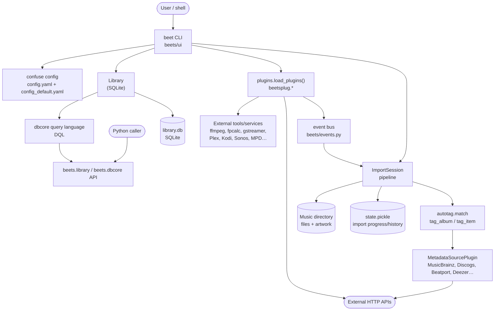
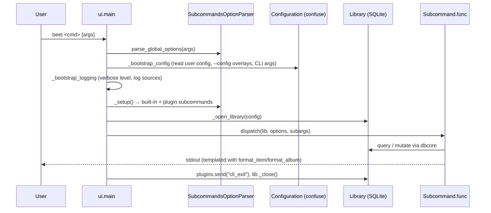
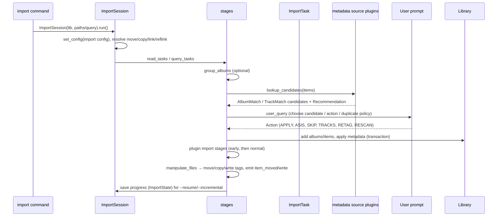

# Architecture

## Architecture Overview

beets is a music library manager: a Python CLI application that also ships as an
importable library, designed so that plugins can extend nearly every part of it.
Its core loop is *import → identify → tag → move/write → record*: `beet import`
scans files, matches them against external metadata sources, applies the result
to tags and paths, and stores the outcome in a local SQLite database.

Architecturally it is a **layered, event-driven command-line application**:

- a `dbcore` object layer over SQLite (models, typed fields, a query language,
  sorting, migrations),
- a `library` domain layer (Item/Album models, path formats, plugin fields),
- an `importer` coroutine pipeline (stages chained through threads or run
  sequentially),
- an `autotag` matching layer over pluggable metadata sources,
- a `ui` command tree and an optparse-based CLI,
- a `plugins`/`metadata_plugins` registry with a typed event bus
  (`beets/events.py`),
- ~72 bundled plugins in `beetsplug/` implementing optional behaviour.

There is no server, no daemon, and no remote storage in the core package. All
state lives on the user's filesystem: the music directory, a SQLite library file,
and a small pickle state file.

---

## 1. Project Structure

```
beets/                          # the installable package (hatchling wheel)
├── dbcore/                     # SQLite object layer, independent of music concepts
│   ├── db.py                   # Database, Model, Transaction, Migration, Results
│   ├── types.py                # field types (String, Integer, PathType, DateType…)
│   ├── query.py                # Query tree (MatchQuery, AndQuery, PathQuery…)
│   ├── queryparse.py           # query-language parser
│   ├── sort.py                 # FieldSort / MultipleSort strategies
│   └── pathutils.py            # byte-path helpers shared with the DB layer
├── library/                    # music library domain layer
│   ├── library.py              # Library(dbcore.Database): Item+Album, migrations
│   ├── models.py               # LibModel, Album, Item, FormattedItemMapping,
│   │                           # DefaultTemplateFunctions
│   ├── fields.py               # fixed field declarations for Item/Album
│   ├── migrations.py           # data migrations run at DB open
│   ├── queries.py              # library-specific query parsing/entry points
│   └── exceptions.py           # ReadError/WriteError/FileOperationError
├── importer/                   # the import pipeline
│   ├── session.py              # ImportSession: config, pipeline assembly, resume
│   ├── stages.py               # stage coroutines (read_tasks … manipulate_files)
│   ├── tasks.py                # ImportTask/SingletonImportTask/ArchiveImportTask
│   ├── actions.py              # Action/DuplicateAction enums (user decisions)
│   └── state.py                # ImportState: tagprogress/taghistory in state.pickle
├── autotag/                    # identification and candidate scoring
│   ├── match.py                # tag_album/tag_item, Match/AlbumMatch/TrackMatch
│   ├── distance.py             # string distance + candidate distance weights
│   └── hooks.py                # AlbumInfo/TrackInfo payloads and plugin hooks
├── ui/                         # CLI
│   ├── __init__.py             # main/_raw_main, Subcommand, option parsers
│   └── commands/               # import, list, modify, move, remove, update,
│                               # write, stats, fields, config, version, help
├── util/                       # cross-cutting helpers
│   ├── functemplate.py         # the $path formatting template language
│   ├── pipeline.py             # coroutine Pipeline (sequential/threaded)
│   ├── artresizer.py           # artwork resizing via backends (PIL/ImageMagick)
│   ├── config.py               # confuse helpers, choice/pair validation
│   ├── deprecation.py          # version-gated deprecation helpers
│   ├── layout.py               # terminal width / progress output
│   ├── hidden.py, m3u.py, diff.py, id_extractors.py, pathformats.py,
│   ├── lyrics.py, extension.py, bluelet.py, color.py, units.py
├── events.py                   # typed registry: event names + payload TypedDicts
├── plugins.py                  # BeetsPlugin, listener registry, event dispatch
├── metadata_plugins.py         # MetadataSourcePlugin + metadata source queries
├── logging.py                  # str-format logger, thread-local verbosity
├── context.py                  # context-local music dir
├── mediafile.py                # mediafile integration / media field registration
├── config_default.yaml         # every default setting
├── exceptions.py               # UserError etc.
├── py.typed                    # ships type information
└── test/                       # test helper library (fixtures, helpers)

beetsplug/                      # bundled plugins (72 modules + 7 subpackages)
├── web/    (Flask JSON/HTML API)   bpd/ (MPD server)      aura/ (aura.py, web UI)
├── discogs/  lastgenre/  metasync/  tidal/  _utils/  _typing.py  types.py
└── *.py    # one module per plugin (fetchart, lyrics, convert, replaygain…)

test/                           # pytest suite mirroring the package layout
├── conftest.py, dbcore/, library/, autotag/, plugins/, ui/, util/, extra/
└── rsrc/                       # fixture audio files, images, databases

docs/                           # Sphinx documentation
├── guides/  reference/  plugins/  dev/  api/  extensions/conf.py
└── changelog.rst

extra/                          # release tooling (release.py), logos, _beet
.github/                        # CI workflows, issue templates, CODEOWNERS
openspec/                       # spec-driven change records (this repo's workflow)
.opencode/, .agents/            # agent tooling configuration (not shipped)
```

Supporting root files: `pyproject.toml` (project metadata, dependency groups,
poe tasks, ruff/mypy config), `uv.lock`, `setup.cfg` (pytest + coverage + mypy
per-module config), `AI_POLICY.md`, `CONTRIBUTING.rst`.

---

## 2. High-Level System Diagram



---

## 3. Core Components

### 3.1 Frontend / User Interface

There is no GUI in core. The UI surfaces are:

**CLI (`beets/ui/`)** — `beet = beets.ui:main`.

- `main()` wraps `_raw_main()` with top-level handlers that convert
  `UserError`, `HumanReadableError`, `FileOperationError`, `ConfigError`,
  `InvalidQueryError`, `DBAccessError`, broken-pipe and `KeyboardInterrupt` into
  friendly messages and exit codes (1 for user errors).
- `_raw_main()` builds a `SubcommandsOptionParser` (optparse subclass), parses
  global options (`-l/--library`, `-d/--directory`, `-v/--verbose`,
  `-c/--config`, `-p/--plugins`, `-P/--disable-plugins`, `--format-item`,
  `--format-album`), bootstraps config and logging, then dispatches to a
  `Subcommand` (`subcommand.func(lib, suboptions, subargs)`).
- Global config errors are deferred until logging exists, so `beet config
  --edit` still works with a broken config file.
- `_open_library()` instantiates `Library` from `config["library"]` and
  `config["directory"]`, and converts SQLite open failures into permission hints.
- `Subcommand`/`CommonOptionsParser` provide the shared `-f/--format`, `-p/--path`,
  album, and query options reused by commands.

Built-in commands (`beets/ui/commands/`): `import`, `list`, `modify`, `move`,
`remove`, `update`, `write`, `stats`, `fields`, `config`, `version`, `help`,
plus shell `completion` (bash).

**HTTP APIs / UIs (plugins)**: `beetsplug/web` (Flask JSON API and a small
HTML UI, routes for `/item`, `/album`, `/item/query/<query>`, `/album/<id>/art`)
and `beetsplug/aura.py` (a separate, newer Flask app with its own blueprint,
default host `127.0.0.1`). `beetsplug/bpd` exposes an MPD-protocol server backed
by GStreamer. All three bind locally by default and are intended for a trusted
network or a reverse proxy.

### 3.2 Backend / Server / API

Not applicable: beets has no server component. The equivalent "backend" is the
`Library` + `dbcore` layer, described next.

### 3.3 Shared Libraries / Common Code

**`beets/dbcore/` — the persistence abstraction.** Deliberately independent of
music semantics.

- `Database` (`db.py`) owns a SQLite file. It keeps **one connection per thread**
  (`_connection()`), a `_shared_map_lock` for the connection/transaction maps,
  and a global `_db_lock` held around transactions (the code documents why:
  SQLite backoff without `HAVE_USLEEP` caused multi-second sleeps).
- Schema is created/updated automatically on open: `_make_table()` creates a
  table from a model's `_fields` (or `ALTER TABLE ADD COLUMN` for new fields),
  `_make_attribute_table()` creates the flex-attribute table, `_create_indices()`
  applies model `_indices`, then `_migrate()` runs registered migrations.
  Applied migrations are recorded in the `migrations(name, table_name)` table.
- Custom SQL functions are registered on every connection: `regexp`,
  `unidecode`, `bytelower` (byte-path case-insensitive comparison workaround).
- `Transaction` provides `query`, `mutate`, `mutate_many`, `script`, and nesting;
  `Results` is the iterable query result with batching.
- `Model` is a dict-like base with three kinds of attributes:
  **fixed** (`_fields: dict[str, Type]` → SQLite columns, fast),
  **flexible** (rows in `<entity>_attributes(entity_id, key, value)`, unlimited,
  plugin-added), and **computed** (read-only values from plugin getters).
  Models track dirty fields and a `_revision`; `_always_dirty` forces writes.
  `_relation`/`relation_join` express a joined sibling table (Album↔Item).
- `types.py` defines the field types: `String`, `DelimitedString`, `Integer`,
  `PaddedInt`, `ScaledInt`, `Float`, `Boolean`, `DateType`, `PathType`
  (paths stored as **bytes**), `MusicalKey`, `DurationType`, each with
  `sql`, `normalize`, `format`, `parse`, `null`, `from_sql`.
- `query.py`/`queryparse.py` implement the query tree (`MatchQuery`, `AndQuery`,
  `OrQuery`, `PathQuery`, `RegexpQuery`, numeric/date variants) and the parser
  for `field:value` syntax; `sort.py` implements `FieldSort`, `FixedFieldSort`,
  `SlowFieldSort`, `MultipleSort`.

**`beets/library/` — the music domain layer.**

- `Library(dbcore.Database)` declares `_models = (Item, Album)` and a tuple of
  nine data migrations (`_migrations`), e.g. `MultiGenreFieldMigration`,
  `RelativePathMigration`, `RemoveInheritedArtpathMigration`,
  `LyricsMetadataInFlexFieldsMigration`. It also holds the music `directory`,
  compiled `replacements`, and `_memotable` caches for path-template expansion.
- `Item` (`_table="items"`, `_flex_table="item_attributes"`) and `Album`
  (`albums`, `album_attributes`) are joined: `Item.album_id` → `albums.id`, and
  album-level fields are *shared* with items so that item queries can filter on
  album fields and templates can use them directly.
- `Item`/`Album` keep media fields (`_media_fields`) read from and written to
  tags via `mediafile`; `LibModel.store()` persists dirty fields, and
  `Item.from_path()` builds an item from a file.
- `DefaultTemplateFunctions` provides the template functions available in path
  formats (`%aunique{}`, `%if{}`, `$lower`, …).
- `fields.py` declares the fixed field registry (the set of columns); plugins can
  add flex fields and item getters at runtime.

**`beets/util/`** — notably `functemplate.py` (parser/compiler for the path
format language: symbols, function calls, conditionals, `%aunique{}`),
`pipeline.py` (see §4/§11), `artresizer.py` (PIL/ImageMagick backends),
`config.py`, `deprecation.py` (user vs maintainer deprecation), `layout.py`
(progress bars), `id_extractors.py` (MusicBrainz/Discogs ID extraction),
`pathformats.py`, `lyrics.py`, `m3u.py`, `hidden.py`, `bluelet.py` (cooperative
scheduler used by `bpd`).

**`beets/plugins.py` + `beets/metadata_plugins.py` + `beets/events.py`.**

- `BeetsPlugin` base class: `config` is `config[self.name]` (a confuse subview),
  per-plugin `template_funcs`, `template_fields`, `album_template_fields`,
  `early_import_stages`, `import_stages`, `_log`. `commands()` returns
  `Subcommand`s. `register_listener(event, func)` is heavily overloaded so each
  event's payload is typed. `add_media_field()` registers a tag ↔ item field.
- Plugin loading: `load_plugins()` reads `config["plugins"]`, resolves each name
  via `pluginpath`, imports it, and instantiates it; `find_plugins()` enumerates
  bundled modules. Only enabled plugins are instantiated.
- Dispatch is `plugins.send(event, **kwargs)` (one overload per event), which
  forwards to listeners registered for that event. `beets/events.py` is the
  canonical contract: a `Literal` union of event names (`import_begin`,
  `import_task_start`, `import_task_before_choice`, `import_task_choice`,
  `import_task_apply`, `import_task_files`, `album_imported`, `item_imported`,
  `before_choose_candidate`, `write`, `after_write`, `item_moved`,
  `item_copied`, `database_change`, `library_opened`, `cli_exit`,
  `mb_album_extract`, `mb_track_extract`, `pluginload`, …), one `TypedDict` per
  payload, and `ALL_EVENTS`.
- `MetadataSourcePlugin` (`metadata_plugins.py`) is the contract for
  identification sources: `album_for_id`, `track_for_id`, `candidates`,
  `item_candidates`, `get_search_response`, `data_source`, plus a
  `data_source_mismatch_penalty`. `SearchApiMetadataSourcePlugin` factors out
  search-based sources. Module-level helpers (`candidates`, `albums_for_ids`,
  `track_for_id`, `get_penalty`, `maybe_handle_plugin_error`) iterate all
  registered sources and swallow per-plugin failures.
- A compatibility shim in `BeetsPlugin.__init_subclass__` keeps legacy plugins
  that only set `data_source` working until v3.0.0 (documented TODO).

### 3.4 CLI / Scripts / Automation

- `beet` entry point → `beets.ui:main`.
- Import commands are dispatched into `beets/importer/` (see §4).
- `extra/release.py` drives releases (`poe bump <version>`, `poe changelog`);
  `.github/workflows/make_release.yaml` calls it, commits the bump, tags, builds
  with `uv build`, and publishes.
- Developer tasks are poe tasks in `pyproject.toml`: `poe install` (`uv sync
  --locked`), `test`, `test-with-coverage`, `lint`, `format`, `check-format`,
  `check-types`, `docs`, `lint-docs`, `format-docs`, `check-docs-links`,
  `update-dependencies`, `build`, `bump`, `changelog`, `check-temp-files`.
- `.pre-commit-config.yaml` runs `poe format` on Python and `poe format-docs`
  on RST.

---

## 4. Data Flow

### 4.1 CLI command lifecycle



### 4.2 Import pipeline (the main runtime flow)

`ImportSession.run()` (`beets/importer/session.py`) assembles a list of
generator-based stages and runs them through `beets/util/pipeline.py`, either
sequentially or on one thread per stage when `config["threaded"]` is true
(default `yes`). Exact composition:

```
read_tasks        (or query_tasks when the import is driven by a query)
  ├─ pretend → log_files
  └─ otherwise:
       group_albums         (if import.group_albums and not singletons)
       ├─ autotag: lookup_candidates → user_query
       └─ else:    import_asis
       plugin early_import_stages   (wrapped per plugin)
       plugin import_stages         (wrapped per plugin)
       manipulate_files             (move/copy/link/reflink/write)
```

Stages are coroutines that receive `ImportTask` objects and yield
`MultiMessage`s; `plugin_stage()` wraps a plugin function, skips `task.skip`,
and calls `task.reload()` afterwards because plugins may have touched the DB.
`plugins.send("import_begin")` fires before the pipeline starts.



Key objects:

- `ImportTask` (`tasks.py`) — one album-sized unit: `items`, `match`, `choice`,
  `duplicate_action`, file operations, and per-task `apply_metadata`/`finalize`
  logic. Variants: `SingletonImportTask` (single non-album files/metadata-only
  updates), `SentinelImportTask` (grouping boundary), `ArchiveImportTask`
  (zip/tar/7z with safe extraction), `MergeTask`.
- `ImportTaskFactory` — turns paths into tasks (`tasks()`, `singleton()`,
  `albums_in_dir()`), including archive detection and numbered-variant
  (CD1/CD2) grouping.
- `Action`/`DuplicateAction` (`actions.py`) — user decisions: `SKIP`, `ASIS`,
  `TRACKS`, `APPLY`, `ALBUMS`, `RETAG`, `RESCAN`; duplicates: skip/merge/remove/
  keep/ask/upgrade.
- `ImportState` (`state.py`) — `tagprogress` (resume) and `taghistory`
  (incremental imports), persisted pickle-style at `config["statefile"]`
  (default `state.pickle`).

### 4.3 Autotagging

`autotag.match.tag_album()`:

1. If the source already carries IDs, try `match_by_id()`; if the recommendation
   is `strong` and `import.timid` is off, return immediately.
2. Otherwise query every metadata source via `metadata_plugins.candidates()`.
3. Score each candidate with `distance.py` (normalized Levenshtein via
   `jellyfish` after `unidecode`, with reduced weights for leading "the",
   `(EP)`/`(single)`, `feat.` clauses, parenthesized/bracketed text, "pt." parts,
   and `&`→`and`), plus source-specific penalties.
4. Sort and classify into `Recommendation` (`none`|`low`|`medium`|`strong`).

`tag_item()` does the equivalent for singletons. `hooks.py` defines the
`AlbumInfo`/`TrackInfo` payloads and the plugin override hooks
(`candidates`, `item_candidates`, `album_for_id`, `track_for_id`,
`before_choose_candidate`). Info payloads are what plugins transform via
`albuminfo_received`/`trackinfo_received`.

---

## 5. Data Stores

| Store | Type | Purpose | Default location |
|---|---|---|---|
| Library database | SQLite | Items, albums, flex attributes, applied migrations | `config["library"]` → `library.db` |
| Music directory | Filesystem | Audio files and album art | `config["directory"]` → `~/Music` |
| Import state | pickle | Resumable import progress + incremental import history | `config["statefile"]` → `state.pickle` |
| User config | YAML | All settings, plugin subviews | confuse config dir (`BEETSDIR` overrides) |
| Plugin caches | Files/DB | Artwork caches, token files, `artpath` references | per-plugin config |

**SQLite schema (created and evolved automatically):**

- `items` — fixed columns from `library/models.py:Item._fields` (identity, title/
  artist/album, disc/track, length, bitrate, format, path as bytes, added, mtime
  and so on) plus `album_id`; index `idx_item_album_id`.
- `albums` — fixed columns from `Album._fields` (albumartist, album, genre, year,
  `artpath`, dates, disambiguating fields…).
- `item_attributes` / `album_attributes` — `(id, entity_id, key, value)` with a
  unique `(entity_id, key)` constraint and an `entity_id` index; this is where
  *flexible* fields live.
- `migrations` — `(name, table_name)` primary key recording applied one-time
  migrations.

**Migration approach:** schema changes are handled in two ways.

1. *Additive column creation* at open time: new fields in `_fields` become
   `ALTER TABLE ADD COLUMN` automatically — no migration class needed.
2. *Data migrations*: subclasses of `dbcore.Migration` (in
   `beets/library/migrations.py`) are registered in `Library._migrations` and run
   once per (migration, table), recording completion in `migrations`. They are
   chunked (`CHUNK_SIZE = 1000`), can swap in a row factory, and receive the
   set of existing columns so they can be skipped when already applied.
   `create_backup_before_migrations` (default `yes`) takes a SQLite-API backup
   before migrating.

**Binary paths**: `path` and `artpath` are stored as bytes (`PathType`), not
text, so filesystem encodings survive round-trips. All display conversion goes
through `util.displayable_path`/`syspath`.

---

## 6. External Integrations / APIs

Identification and enrichment (all via `MetadataSourcePlugin`, configured under
each plugin's config section, HTTP through `requests` with retry sessions):

| Integration | Plugin | Notes |
|---|---|---|
| MusicBrainz | `beetsplug/musicbrainz.py` (+ `_utils/musicbrainz.py`) | Default enabled plugin; **rate limited** (default 1 req/s, `musicbrainz.ratelimit`/`ratelimit_interval`, `LimiterTimeoutSession`); user agent identifies beets |
| Discogs | `beetsplug/discogs/` | OAuth (app key/secret, `authenticate()`), optional dependency |
| Beatport | `beetsplug/beatport.py` | OAuth2 token flow |
| Deezer | `beetsplug/deezer.py` | Public API |
| Spotify | `beetsplug/spotify.py` | Client-credentials token for track lookups |
| TIDAL | `beetsplug/tidal/` | OAuth2 PKCE, token persisted |
| AcoustID / Chromaprint | `beetsplug/chroma.py` | Requires `fpcalc`/chromaprint binary |
| Album art | `beetsplug/fetchart.py`, `embedart.py`, `thumbnails.py` | fanart.tv, AlbumArtExchange, iTunes, Deezer, Wikipedia/Wikimedia (BeautifulSoup scraping), local files |
| Lyrics | `beetsplug/lyrics.py` | Multiple scrapers/APIs, language detection |
| Last.fm | `beetsplug/lastgenre/`, `lastimport.py`, `mpdstats.py` | Tag/genre suggestions |
| ListenBrainz | `beetsplug/listenbrainz.py` | Scrobbling |

Local players/hosts (credential or URL configured, failures logged, never fatal):

| Target | Plugin |
|---|---|
| Plex | `plexupdate.py` (token/PIN UI flow in `ui_authenticate_flow`) |
| Kodi | `kodiupdate.py` |
| Sonos | `sonosupdate.py` |
| Emby | `embyupdate.py` (`get_token` device login) |
| MPD server | `bpd/` (GStreamer) |
| Subsonic | `subsonicupdate.py`, `subsonicplaylist.py` |
| Any | `hook.py` runs configured shell commands on events |

External binaries (not Python dependencies) are documented next to their extras
in `pyproject.toml`: `ffmpeg` (convert), `fpcalc`/chromaprint (chroma),
`mp3val`/`flac` (badfiles), ImageMagick (embedart/fetchart/thumbnails),
gstreamer + PyGObject (bpd, replaygain), `mp3gain`/`aacgain`, `KeyFinder`.
Failure behaviour is per-plugin: `raise_on_error: no` by default, and metadata
source failures are caught per plugin by `maybe_handle_plugin_error`.

---

## 7. Key Technologies

| Technology | Role | Architectural relevance |
|---|---|---|
| Python 3.11–3.15 | runtime | No 3.10 support; `from __future__ import annotations` everywhere |
| uv + uv.lock | dependency/env management | Reproducible envs; CI uses `uv tool install poethepoet` + `poe install` |
| hatchling | build backend | Wheel ships `beets` + `beetsplug`; sdist includes docs/tests/man |
| poethepoet (`poe`) | task runner | Single entry point for install/test/lint/docs/release in CI and pre-commit |
| SQLite (stdlib `sqlite3`) | persistence | Per-thread connections, global write lock, custom SQL functions, optional extensions |
| confuse + PyYAML | configuration | Layered file overlays, plugin subviews, `BEETSDIR` |
| requests + requests-ratelimiter | HTTP | Rate-limited MusicBrainz sessions, retries |
| mediafile | tag I/O | Media fields bridged into Item fields |
| jellyfish / unidecode | matching | Edit distance on transliterated ASCII |
| numpy | analysis | ReplayGain/BPM plugins |
| Flask / flask-cors | web APIs | `web` and `aura` plugins |
| Sphinx (+ sphinx-design, sphinx-copybutton, sphinx-toolbox) | docs | API docs via autodoc/autosummary, `:bug:` extlinks |
| ruff | lint + format | line length 80, py310 target, selected rule families |
| mypy | typing | `strict` for `beetsplug.musicbrainz`, `mbpseudo`, `_utils`, `tidal.*`; ships `py.typed` |
| pytest (+ xdist, randomly, factoryboy, flask, cov) | tests | `-n auto --dist=loadscope`, randomized order |
| responses / requests-mock | HTTP fixtures | No network in unit tests |

---

## 8. Deployment & Infrastructure

- **Distribution**: PyPI wheel/sdist built by hatchling (`poe build` also builds
  the man page from Sphinx). Console script `beet`.
- **Hosting/docs**: readthedocs (`https://beets.readthedocs.io`), homepage
  `https://beets.io`.
- **CI (`.github/workflows/`)**:
  - `ci.yaml` — on PR, merge queue and master: a `base-install` job (installs
    without dev deps and runs `beet version`) and a `test` matrix of
    **Ubuntu + Windows** × **Python 3.11–3.15**, including system dependencies
    (ffmpeg, gstreamer, imagemagick, mp3gain on Ubuntu; equivalents on Windows),
    an MSYS2 bash-completion check, reflink-capable temp dir, pytest annotations,
    and Codecov upload.
  - `lint.yaml` — change-scoped jobs: `format` (ruff format --check), `lint`
    (ruff check), `mypy`, `docs` (docstrfmt/sphinx-lint), skipping files that did
    not change (a changed `uv.lock` forces a full run).
  - `integration_test.yaml` — weekly cron, installs heavy extras
    (autobpm, discogs, lyrics, replaygain, reflink, fetchart, chroma,
    sonosupdate) and runs `INTEGRATION_TEST=1`, the docs build and linkcheck;
    notifies a Zulip stream on failure.
  - `changelog_reminder.yaml` — comments on PRs that touch Python without
    touching `docs/changelog.rst`.
  - `make_release.yaml` — manual dispatch: bump version via `extra/release.py`,
    commit+tag, build, publish release notes from the changelog.
  - `label-issues.yaml` — regex-based issue/PR labeling from
    `.github/labeler.yaml`.
- **No containers, no infrastructure-as-code**: this is a distributed CLI, so
  deployment is "publish a wheel".
- `.github/CODEOWNERS` assigns the repo to `@beetbox/maintainers` with specific
  paths to named maintainers (`beets/metadata_plugins.py`, `beetsplug/tidal/*`,
  `plexupdate.py`, `titlecase.py`, `mbpseudo.py`, `_utils/requests.py`,
  `_utils/musicbrainz.py`, `musicbrainz.py`, `lastgenre/*`).

---

## 9. Security Architecture

beets is a **local-first tool with no authentication layer**; the trust boundary
is the user's own filesystem and account.

- **No authN/authZ in core.** The `web` and `aura` plugins serve unauthenticated
  HTTP; both are expected to bind to localhost (aura's default host is
  `127.0.0.1`) or sit behind a reverse proxy that terminates auth. Exposing them
  directly is a user error the code does not prevent.
- **Credentials** are stored in the user's config file (Discogs/Beatport/TIDAL
  keys, Plex token, Subsonic passwords) or plugin-managed token files; they are
  never embedded in the database or logs. `confuse` config files should be
  user-read-only — nothing enforces this.
- **Filesystem safety**: import operations detect and avoid overwriting outside
  the library directory, archives are extracted with path-traversal checks
  (`ArchiveImportTask`), and move/copy/link choices are mutually exclusive
  (`set_config`). `permissions.py` lets users re-apply a configured file mode.
- **Input validation**: the query language is parsed into a `Query` tree (no
  string concatenation of user text into SQL); values are bound parameters.
  The `regexp` SQL function compiles user regexes — a hostile regex is a local
  DoS, not an RCE.
- **Network**: all traffic is outbound HTTPS to known services, identified by a
  beets user agent; rate limits protect the upstream services.
- **Repository policy** (`AI_POLICY.md`): agents may interact with the repo
  **only for code review** — no agent-created PRs, issues, or comments under a
  contributor's account; AI use must be disclosed in PRs; AI-written comments
  must be concise. This governs how automation may act on this repository.

---

## 10. Monitoring & Observability

- **Logging is the only observability mechanism** (`beets/logging.py`): a
  `logging.getLogger` wrapper returning `BeetsLogger` (str-format `{}` style,
  `extra_debug()`) with `LegacyFormatter` emitting the historical
  `artist - album - title`-style prefixes, plus `ThreadLocalLevelLogger` so
  plugins can raise/lower verbosity per thread (used by import stages).
- Verbosity: `-v`/`-vv` and `config["verbose"]` set the global level;
  `config.log_sources(log)` prints every config file that contributed.
- Import sessions log to a per-session logger with a handler supplied by the
  caller, so `beet import -l logfile` captures the run.
- No metrics, tracing, or error reporting service. Failures surface as
  human-readable log lines and non-zero exit codes; tracebacks are logged at
  debug level before the friendly message.
- CI observability: pytest annotations, JUnit XML (`.reports/pytest.xml`),
  coverage XML/HTML under `.reports/`, Codecov status checks (informational,
  non-blocking).

---

## 11. Performance & Scalability

- **Import concurrency**: stages run as coroutines connected by queues
  (`beets/util/pipeline.py`). `Pipeline.run_parallel(QUEUE_SIZE)` starts a thread
  per stage, so tagging (network-bound), file operations (I/O-bound) and DB
  writes overlap; `run_sequential()` is the deterministic fallback. Thread count
  is bounded by the number of stages, not by an arbitrary pool.
- **HTTP rate limiting** is the hard ceiling on import throughput: MusicBrainz
  defaults to 1 request/second (`ratelimit` per `ratelimit_interval`), enforced
  by `requests_ratelimiter.LimiterMixin`; other sources use
  `RateLimitAdapter` (~4 req/s default in `_utils/requests.py`). Imports are
  therefore network-latency-bound, and candidate lookups are batched per album.
- **Database performance**: fixed fields live in wide tables (fast reads and
  queries); flexible fields live in attribute tables joined on demand, so queries
  on flex fields are slower (`SlowFieldSort` exists for that reason). Per-thread
  connections avoid contention; the global write lock serializes transactions
  (chosen over SQLite's busy-timeout behaviour, see §3.3).
- **Path template caching**: `Library._memotable` and `_group_memotable` memoize
  template substitution, `get_empty_component_replace()` and
  `get_max_filename_length()` snapshot their configuration once per process
  (`util.clear_path_caches()` resets them), and `FormattedItemMapping` fetches an
  item's album only when the requested key needs an album value — path generation
  is on the hot path of every import, move, and plugin that computes
  destinations.
- **Bulk sync plugins** (`beets-alternatives`): read `lib.items()` and
  `lib.albums()` once per run, group them in memory, and keep the run's database
  writes in one transaction — a per-item `store()` commits (and syncs the
  journal) every time, which dominates the run on a network-mounted library.
- **UI latency**: `format_item`/`format_album` templates are compiled once
  (`functemplate.Template.translate`) and evaluated per object.
- **Known bottlenecks**: MusicBrainz rate limits; artwork fetching per candidate;
  `-n auto` test parallelism is limited by disk-heavy tests; `bareasc`/`unicode`
  lookups are slow on large libraries; album-level field denormalization means
  updates must touch both tables.

---

## 12. Development Workflow

```bash
# tooling
uv tool install "poethepoet>=0.26,<0.47.0"

# install (creates .venv, installs dev dependency groups)
git clone https://github.com/beetbox/beets.git && cd beets
uv sync                       # or: poe install
uv sync --extra fetchart      # plugin extras

# everyday
poe test                      # uv run pytest (xdist, no coverage)
poe test --lf                 # pass pytest options through
poe test-with-coverage
poe lint                      # ruff check
poe format                    # ruff format
poe check-format
poe check-types               # mypy
poe docs                      # sphinx html
poe lint-docs                 # sphinx-lint + backtick rule
poe format-docs               # docstrfmt
poe check-docs-links          # sphinx linkcheck (network)
```

Conventions that matter:

- Every user-visible change needs a `docs/changelog.rst` entry (with `:bug:` /
  `:user:` roles and issue/PR refs) in the same PR; a workflow reminds you.
- Commit subjects are area-prefixed with a PR number, e.g.
  `convert: skip missing album art instead of crashing (#6749)`.
- Contributions follow `CONTRIBUTING.rst` (issue → discussion → PR, tests
  required, docs updated); `AI_POLICY.md` restricts agent participation to code
  review.
- Pre-commit runs formatting; CI runs format/lint/mypy/docs on changed files and
  the pytest matrix everywhere.

---

## 13. Testing Strategy

- **Framework**: pytest, configured in `setup.cfg` (not `pyproject.toml`):
  `-ra -n auto --dist=loadscope --strict-config`, JUnit XML to `.reports/`,
  cache in `/tmp`, `-p no:cov` default in the poe task.
- **Layout**: `test/` mirrors the package — `dbcore/`, `library/`, `autotag/`,
  `plugins/`, `ui/` (+ `ui/commands/`), `util/`, `extra/`, plus top-level
  modules (`test_importer.py`, `test_library.py`, `test_plugins.py`,
  `test_metadata_plugins.py`).
- **Fixtures**: `test/conftest.py` and `beets/test/helper.py` (a plugin-enabled
  `TestHelper`, temp `BEETSDIR`, library and media-file factories),
  `pytest-factoryboy` factories, real files in `test/rsrc/` (audio, images,
  databases), `pytest-flask` for the web plugin.
- **Network**: `responses` and `requests-mock` everywhere; `test/plugins/conftest.py`
  patches the rate-limited session so mocked requests are not throttled.
- **Determinism**: `pytest-randomly` shuffles order; `--dist=loadscope` keeps a
  test class/module on one xdist worker.
- **Integration tier**: weekly `integration_test.yaml` runs with
  `INTEGRATION_TEST=1` and heavy extras installed (audio analysis, real
  transcoding, ReplayGain, Sonos/Discogs clients) — this is where external
  binary paths are actually exercised.
- **Coverage**: branch coverage, parallel data files, uploaded to Codecov;
  project and patch statuses are **informational only** (no gate).
- **Gaps**: no load/benchmark suite (CONTRIBUTING explicitly asks for one), no
  Windows-specific fixtures beyond the CI matrix, plugin tests rely heavily on
  mocks rather than real services.

---

## 14. Architectural Decisions & Rationale

| Decision | Rationale | Trade-off |
|---|---|---|
| SQLite as the only store, accessed through `dbcore` models | Zero-config, single file, portable; typed models give plugins queries for free | Global write lock limits write concurrency; flex attributes need joins |
| Fixed + flexible + computed fields | Fixed columns stay fast; plugins can add fields without migrations; computed fields stay read-only/derived | Two storage paths to reason about; flex queries are slow |
| Album fields shared onto items (relation join) | Template and query semantics treat album metadata as item metadata | Denormalized data must be kept consistent on store/migrate |
| Coroutine pipeline with real threads | Overlaps network, disk and DB work without an async rewrite of blocking libraries | One thread per stage; error propagation needs pipeline abort handling |
| Event bus with typed payloads (`events.py`) instead of subclassing | Stable extension contract; mypy can verify listeners | Large overload surface in `plugins.send`; legacy shims needed |
| Pluggable metadata sources (`MetadataSourcePlugin`) | MusicBrainz is not always right; Discogs/Beatport/Deezer/Spotify/TIDAL add coverage | Scoring across sources with different penalties is heuristic |
| Path formatting as a template language (`functemplate`) | Users control their on-disk layout; templates can be stored/config'ed | It is a stability boundary: changes can relocate users' files |
| Migrations recorded per (name, table) | Idempotent, re-runnable, safe with interrupted upgrades | Requires discipline: any data-changing release needs a migration class |
| Changelog-in-PR policy + reminder workflow | Releases are generated from `docs/changelog.rst` | Merge conflicts on a hot file; bot comments |
| uv + poe in CI and docs | Reproducible envs, one task interface | Older contributor setups break; tooling must be installed separately |
| Monolithic `beetsplug/` package | Simple discovery (`find_plugins`) and no entry-point metadata | 72 modules with uneven dependency/testing quality |

---

## 15. Constraints, Risks, and Technical Debt

- **Migrations are the highest-risk change class.** `library/models.py` /
  `library/fields.py` edits can require a `Migration` subclass; a broken
  migration damages users' only copy of their library DB (backups are on by
  default but not guaranteed if disabled).
- **Path-format compatibility.** `functemplate.py`, `pathformats.py` and the
  `aunique/sunique/tunique` semantics define where files land; regressions
  duplicate or move user libraries.
- **Plugin surface = long tail.** 72 plugins with external binaries/services;
  many paths are only covered weekly or manually, and optional dependency sprawl
  (single-key extras, OS-conditional gstreamer pins) makes auditing hard.
- **Album/item denormalization.** Album-level edits must propagate to items;
  recent history includes a bug where album `store()` copied an absolute
  `artpath` onto items, fixed by a migration — the class of defect to watch for.
- **SQLite write serialization.** The global `_db_lock` is deliberate; adding
  write-heavy features can regress import throughput.
- **`db.query`/query language surface** is user-visible in docs
  (`docs/reference/query.rst`); changing syntax or semantics breaks scripts and
  plugins.
- **Deprecation debt**: legacy `data_source` plugins, `source_weight` →
  `data_source_mismatch_penalty`, all marked "remove in v3.0.0".
- **Documentation toolchain strictness**: RST + `sphinx-lint --enable all` +
  `docstrfmt` reject plain-Markdown habits and single-backtick literals.
- **Windows/macOS differences** (byte paths, MSYS2 bash-completion test,
  gstreamer bundle pins, path separators) are tested but remain a source of
  platform-only bugs.
- **Repository automation policy**: `AI_POLICY.md` forbids agents from opening
  PRs/issues or commenting as a contributor; automation must stay on the
  review side. Ignoring this gets contributions closed.

---

## 16. Future Considerations

Documented roadmap signals found in the code (not speculation):

- **v3.0.0 cleanup** — `TODO: Remove in v3.0.0` shims in
  `plugins.BeetsPlugin.__init_subclass__` (legacy metadata sources),
  `_verify_config` (`source_weight`), and the deprecation helpers.
- **Migration direction already in flight** — the repo moved from Poetry to
  uv/hatchling and reorganized tests (`test/util`, `test/extra`); expect further
  consolidation of plugin utilities under `beetsplug/_utils/`.

Recommendations (explicitly suggestions, not commitments):

- Add a benchmark harness (CONTRIBUTING asks for one) to guard import-path
  performance, especially template expansion and flex-field queries.
- Consider making `library.db` schema changes testable with fixture databases at
  older versions, so migrations get regression coverage beyond unit tests.
- Consider documenting the web/aura trust model in the docs (no auth, localhost
  default) to reduce the chance of accidental exposure.
- Group `beetsplug/` by category in the tree or at least in the docs index to
  keep discovery manageable as the plugin count grows.

---

## 17. Project Identification

| Field | Value |
|---|---|
| Name | beets |
| Version reviewed | 2.14.1 (HEAD `e978874d1`) |
| Language | Python (>=3.11,<3.16) |
| Type | CLI application + importable library, plugin-extensible |
| Runtime | CPython; SQLite; optional external binaries |
| License | MIT |
| Maintainer | beetbox maintainers (`@beetbox/maintainers`), lead listed as Serene-Arc |
| Repository | https://github.com/beetbox/beets |
| Documentation | https://beets.readthedocs.io |
| Date of review | 2026-11-07 |

---

## 18. Glossary / Acronyms

| Term | Meaning |
|---|---|
| **Item** | One track/file record in the library (`items` table). |
| **Album** | A release grouping items (`albums` table); some fields are shared onto items. |
| **Flexible attribute / flex field** | A plugin- or user-defined field stored in `item_attributes`/`album_attributes` rather than a column. |
| **Fixed field** | A field declared in `_fields`, stored as a real SQLite column. |
| **Computed field** | Read-only field produced by a plugin getter, not stored. |
| **DQL / query language** | beets' `field:value` query syntax parsed by `dbcore/queryparse.py` (e.g. `year:1999..2003`, `path::^/home`, `-genre:rock`). |
| **`dbcore`** | The generic SQLite model/query layer, independent of music concepts. |
| **`Library`** | Domain subclass of `Database` holding `Item`/`Album`, migrations and path formats. |
| **Import task** | One unit of import work (an album, or one file); carries items, match, and decision. |
| **Import stage** | A generator coroutine in the import pipeline (`read_tasks`, `user_query`, `manipulate_files`…). |
| **Singleton import** | Import of individual files not treated as an album. |
| **Metadata source / `MetadataSourcePlugin`** | A backend that can identify releases/tracks (MusicBrainz, Discogs, Beatport…). |
| **autotag** | The process of matching items to a metadata source and applying its metadata. |
| **Recommendation** | Enum `none|low|medium|strong` describing match confidence. |
| **`AlbumMatch` / `TrackMatch`** | Candidate objects pairing a source with `AlbumInfo`/`TrackInfo`. |
| **Path format** | A template such as `$albumartist/$album%aunique{}/$track $title` expanded by `functemplate`. |
| **`aunique`/`sunique`/`tunique`** | Template functions that disambiguate album/single/track collisions when expanding paths. |
| **`artpath`** | Stored path to an album's artwork file. |
| **`statefile`** | `state.pickle` holding import progress (resume) and history (incremental). |
| **`BEETSDIR`** | Environment variable overriding the config directory. |
| **`poe`** | poethepoet task runner; all repo tasks are defined in `pyproject.toml`. |
| **`uv`** | Package/environment manager used for installs, locks, builds, CI. |
| **`aura` / `web`** | Two Flask-based web interfaces shipped as plugins. |
| **`bpd`** | beets' MPD-protocol player plugin (GStreamer). |
| **`mb_*`** | MusicBrainz-prefixed events/config (`mb_album_extract`, `musicbrainz.ratelimit`). |
| **DQL `bareasc`** | Query using only ASCII (`bareasc:`) for transliterated matching. |

<!-- Last updated: 2026-11-07T23:58:00+01:00 -->
